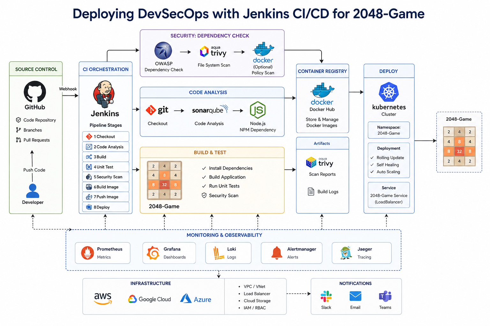

<div align="center">

# ☁️ CloudForge — DevSecOps CI/CD Pipeline 🚀

### 🔐 Secure • ⚙️ Automated • ☸️ Cloud-Native

**An end-to-end DevSecOps project for secure application delivery using CI/CD, Infrastructure as Code, and Kubernetes.**

[🌐 GitHub Repository](https://github.com/abhisheksaste31-source/CloudForge-DevSecOps-Pipeline) · [💼 LinkedIn](https://www.linkedin.com/in/abhisheksaste)

</div>

> 💡 **Mission:** Automate software delivery while integrating security checks across the pipeline.

    

## 🌟 Project Overview

**CloudForge** demonstrates a DevSecOps delivery workflow for a React and TypeScript application (2048). The project brings together source control, Jenkins-based CI/CD, code quality checks, dependency and container vulnerability scanning, Docker image delivery, and Kubernetes deployment. Terraform infrastructure code is organized under `EKS_TERRAFORM/`.

> **Implementation note:** The repository contains application, Docker, Kubernetes, and Terraform files. The architecture below also illustrates a broader target toolchain. Validate the Jenkins pipeline, scan integrations, monitoring components, notifications, and cloud resources against your actual deployment before describing them as fully operational.

## 🏗️ Architecture

<div align="center">



</div>

**Architecture image:** [`architucture/Architucture.png`](architucture/Architucture.png)

> GitHub paths are case-sensitive. If your uploaded image uses a different spelling or capitalization, update both references above to match it exactly.

### 🔄 Delivery Flow

```text
Developer → GitHub → Jenkins CI/CD
                          │
                          ├── Checkout source
                          ├── Code analysis (SonarQube)
                          ├── Dependency check (OWASP)
                          ├── Install dependencies / build / test
                          ├── File-system and image scanning (Trivy)
                          ├── Docker build and image push
                          └── Kubernetes deployment
                                       │
                                       ▼
                              Application service

Terraform → AWS infrastructure / EKS provisioning
Monitoring (architecture): Prometheus, Grafana, Loki, Alertmanager, Jaeger
Notifications (architecture): Slack, email, Microsoft Teams
```

## 🧰 Technology Stack

| Area | Technologies |
| --- | --- |
| Application | React, TypeScript, Node.js |
| Source control | Git, GitHub |
| CI/CD | Jenkins |
| Infrastructure as Code | Terraform |
| Cloud and orchestration | AWS, Amazon EKS, Kubernetes |
| Containers and registry | Docker, Docker Hub |
| Code quality | SonarQube |
| Security | OWASP Dependency-Check, Trivy |
| Observability (architecture) | Prometheus, Grafana, Loki, Alertmanager, Jaeger |
| Notifications (architecture) | Slack, email, Microsoft Teams |

## 📂 Repository Structure

```text
CloudForge-DevSecOps-Pipeline/
├── EKS_TERRAFORM/           # Terraform infrastructure code
├── architucture/            # Architecture diagram
│   └── Architucture.png     # Confirm exact filename/case
├── public/                  # Static application assets
├── src/                     # React/TypeScript source
├── Dockerfile               # Container build definition
├── deployment.yaml          # Kubernetes resource manifests
├── package.json             # Application scripts/dependencies
├── yarn.lock                # Dependency lockfile
├── craco.config.js          # React build configuration
├── tsconfig.json            # TypeScript configuration
├── LICENSE
└── README.md
```

## 🚀 Getting Started

### 📥 Step 1 — Clone the Repository

```bash
git clone https://github.com/abhisheksaste31-source/CloudForge-DevSecOps-Pipeline.git
cd CloudForge-DevSecOps-Pipeline
```

### 💻 Step 2 — Run Locally

Install a compatible Node.js version and Yarn, then run:

```bash
yarn install
yarn start
```

Open **http://localhost:3000**.

For a production build:

```bash
yarn build
```

### 🐳 Step 3 — Build a Docker Image

```bash
docker build -t cloudforge-app:latest .
docker images
```

To push an image to Docker Hub, replace `<dockerhub-username>` with your account:

```bash
docker login
docker tag cloudforge-app:latest <dockerhub-username>/cloudforge-app:latest
docker push <dockerhub-username>/cloudforge-app:latest
```

### 🏗️ Step 4 — Provision with Terraform

Review the files, variables, provider configuration, state backend, and expected AWS costs in `EKS_TERRAFORM/` before applying:

```bash
cd EKS_TERRAFORM
terraform init
terraform fmt -check -recursive
terraform validate
terraform plan
# Only after reviewing the plan:
terraform apply
```

> Terraform can create billable AWS resources. Use least-privilege credentials and never commit secrets or state files.

### ☸️ Step 5 — Deploy to Kubernetes

Ensure `kubectl` points to the intended cluster and that `deployment.yaml` references an image you can pull:

```bash
kubectl config current-context
kubectl apply -f deployment.yaml
kubectl get deployments,pods,services
kubectl rollout status deployment/<deployment-name>
```

Replace `<deployment-name>` with the actual Deployment metadata name from `deployment.yaml`. The cluster must already exist and be accessible.

## ⚙️ CI/CD Pipeline Stages

The architecture describes the following intended stages:

1. **Checkout:** Fetch the latest application code from GitHub.
2. **Code analysis:** Analyze code quality using SonarQube.
3. **Dependency security:** Scan third-party packages using OWASP Dependency-Check.
4. **Build and test:** Install dependencies, build the application, and execute available tests.
5. **Container security:** Scan files or Docker images using Trivy.
6. **Publish:** Push the validated Docker image to a registry.
7. **Deploy:** Update the application on Kubernetes.
8. **Observe:** Inspect metrics, logs, alerts, and traces where configured.

Configure Jenkins credentials, webhooks, scanner installations, registry authentication, and Kubernetes access for your environment. Do not put passwords or tokens directly in a Jenkinsfile.

## 🛡️ Security Practices

- Scan application dependencies and container images.
- Keep secrets in a credential manager or Kubernetes Secrets backed by appropriate access controls.
- Review vulnerability findings and define quality gates before production deployment.
- Restrict cloud IAM permissions and Kubernetes RBAC.
- Pin and periodically update dependencies and base images.
- Keep Terraform state in a secure backend when collaborating.

## ✅ Validation Checklist

- [ ] Application starts locally
- [ ] Docker image builds successfully
- [ ] Terraform configuration validates
- [ ] Infrastructure plan is reviewed
- [ ] Jenkins pipeline completes successfully
- [ ] SonarQube analysis and security scans run
- [ ] Docker image is available in the registry
- [ ] Kubernetes deployment becomes ready
- [ ] Application is reachable through its service
- [ ] Monitoring and alerting are verified, if configured

## 🔮 Future Enhancements

- Enforce automated security and quality gates.
- Add image signing and software bill of materials (SBOM) generation.
- Introduce GitOps-based deployment workflows.
- Add automated integration and end-to-end tests.
- Extend dashboards and alert routing.

## 🔗 Repository

**Source:** https://github.com/abhisheksaste31-source/CloudForge-DevSecOps-Pipeline

## 📜 License

See the repository's [`LICENSE`](LICENSE) file for licensing terms.

## 👨‍💻 Author

**👤 Abhishek Saste**  
**LinkedIn:** [linkedin.com/in/abhisheksaste](https://www.linkedin.com/in/abhisheksaste)  
**GitHub:** [abhisheksaste31-source](https://github.com/abhisheksaste31-source)

---

<div align="center">

### ⭐ If this project helped you, consider starring the repository!

**Built with ☁️ cloud engineering, 🔐 security, and ❤️ automation.**

</div>
